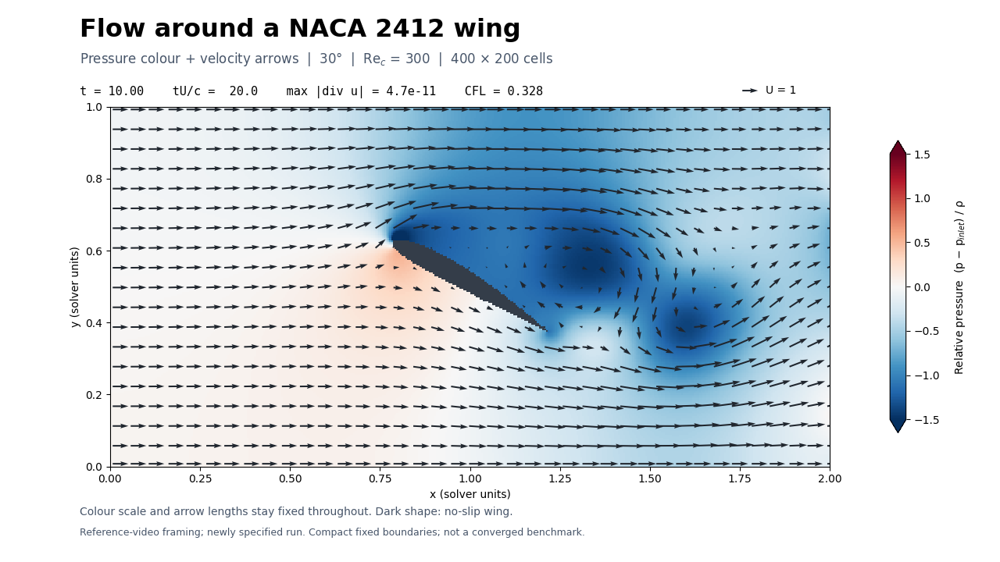

# Navier-Stokes: NACA-profile objects in 2D flow

## Pressure and velocity video (YouTube equivalent)

[](movies/naca_pressure_velocity_corrected.mp4)

[Watch the corrected pressure-and-velocity video](movies/naca_pressure_velocity_corrected.mp4).
This reproduces the **pressure colours and velocity arrows** of the historical
[YouTube video](https://www.youtube.com/watch?v=TGbapm781wk), with the same 2 × 1
domain framing. The newly specified case is NACA 2412 at 30°, chord 0.5,
Reynolds number 300 based on chord, and 400 × 200 cells (100 cells per chord).
It runs to time 10 and produces a 10-second, 1280 × 720 MP4 at 20 fps.

```sh
OPENBLAS_NUM_THREADS=1 python render_naca_pressure.py
```

Pressure is relative to the instantaneous upstream mean; colour limits and
velocity-arrow scaling remain fixed throughout the movie. The wing interior is
masked. The original upload does not establish its exact Reynolds number or
timestep, so this is a corrected visual equivalent, **not an exact replay of
unverified historical parameters**. The compact fixed boundaries influence the
flow. See the accompanying JSON and CSV for settings and diagnostics.

### Render inventory

| Video | Status |
| --- | --- |
| `movies/naca_pressure_velocity_corrected.mp4` | New corrected pressure + velocity view, matching the reference's presentation |
| `movies/naca_wake_corrected.mp4` | New corrected vorticity + probe view, wider domain |
| `movies/cylinder_wake_corrected.mp4` | New corrected cylinder validation example |
| Other MP4s in `movies/` | Historical outputs; **not re-rendered** with the corrected solver |

## NACA wing vorticity video

[](movies/naca_wake_corrected.mp4)

The requested wing is **NACA 2412 at 30°**, matching the notebook profile and first angle. Chord 2, Reynolds number 300 based on chord, 400 × 160 cells, and no imposed perturbation. Reproduce with `OPENBLAS_NUM_THREADS=1 python render_naca.py`. Settings and diagnostics accompany the MP4. This remains a finite-grid demonstration, not a converged aerodynamic benchmark.

## Cylinder validation video

[](movies/cylinder_wake_corrected.mp4)

[Watch the corrected cylinder wake](movies/cylinder_wake_corrected.mp4). The video
shows signed vorticity and a downstream velocity probe, with divergence and CFL
reported on every frame. It uses a 400 × 160 grid, a unit-diameter cylinder,
Reynolds number 150 based on that diameter, and 60 flow-time units.

The obstacle pressure correction now uses the same blocked faces as the velocity
update. Fixed boundaries remain fixed, pressure has an explicit reference, and
parameter sweeps start each case independently. See [numerical details and
validation](NUMERICS.md), [run metadata](movies/cylinder_wake_corrected.json), and
[frame diagnostics](movies/cylinder_wake_corrected.csv).

This is a numerical wake demonstration. The staircase geometry, finite domain,
and fixed far-field/outlet velocities have not been validated as a converged
force or shedding-frequency benchmark.

## Run

Python 3.10+:

```sh
python -m pip install -r requirements.txt
python -m unittest discover -s tests -v
OPENBLAS_NUM_THREADS=1 python render_wake.py
```

Install FFmpeg and put it on `PATH` to encode the MP4. The simulation can run
without it using `python render_wake.py --simulate-only`; use `--render-only` to
render the cached fields afterwards. Intermediate fields are kept in `.cache/`
and are not committed. The script saves the MP4, a final-frame PNG, a diagnostics
CSV, and JSON containing settings, dependency versions, and source hashes.

`Execute_simulation.ipynb` remains the entry point for NACA angle/velocity sweeps.
Its saved 1200 × 600 setup is expensive; lower `multi_arr` for exploratory runs.
`const.cholesky=True` caches sparse factorizations, using CHOLMOD when installed
and SciPy LU otherwise. `False` uses direct SciPy solves on each step.

## Historical video

The earlier video below predates the numerical corrections and is retained as
historical output.

[](https://www.youtube.com/watch?v=TGbapm781wk)

## Structure

*create_animation.ipynb*: Contains function for making a animation from premade figures

*Execute_simulation.ipynb*: Main file which executes the NS simulation. This contains the set-up of the simulation.

---

*constants.py*: Contains the constants of the system

*data_processing.py*: Contains plotting functions

*functions.py*: Contains all functions needed to perform the simulation (generated the wanted data).

*simulation.py*: Contains the simulation functions of the NS solver

*operators.py*: Compatible pressure operator, obstacle diffusion, and diagnostics.

*render_wake.py*: Reproducible cylinder simulation and video rendering.

*render_naca.py*: Wing vorticity and probe video.

*render_naca_pressure.py*: Wing pressure and velocity video matching the historical presentation.

*tests/test_solver.py*: Numerical regression checks, also run in GitHub Actions.

*tests/test_pressure_video.py*: Gauge-invariance check for the displayed pressure.
